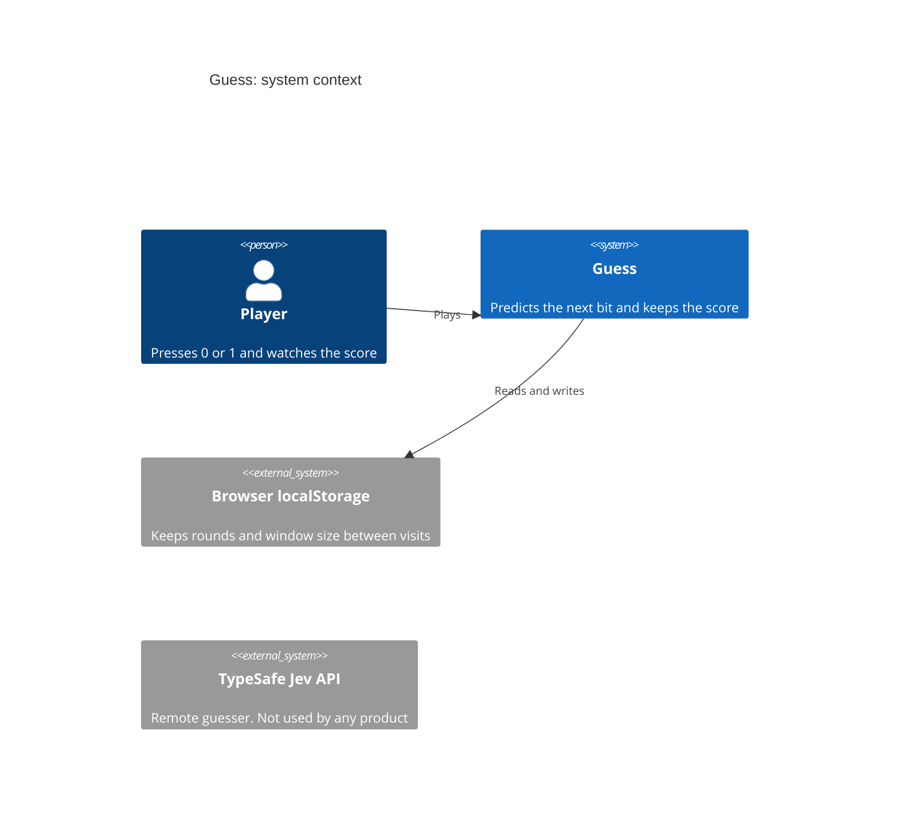
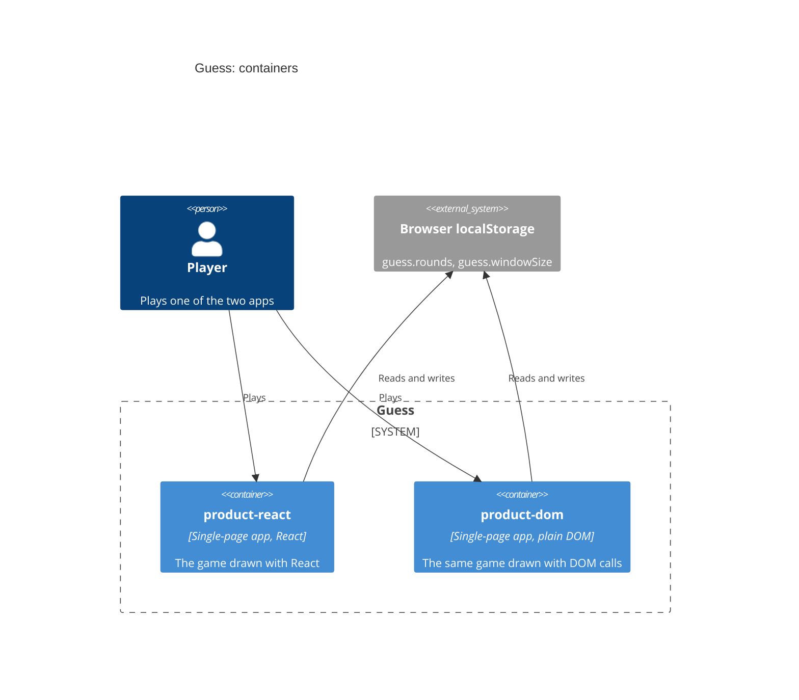
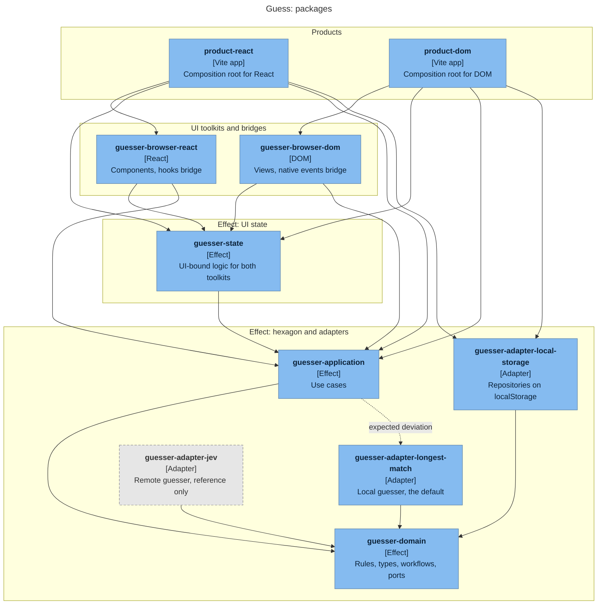

# Guess

Guess is a small browser game. You press 0 or 1, and the guesser tries to predict your next bit from the bits you pressed before.

The game is a demonstration of hexagonal architecture and DDD in a TypeScript + [Effect](https://effect.website) frontend. One domain and one application layer run under two UI toolkits, React and plain DOM, with no shared rendering code.

## Live demos

- React: https://s4ysolutions.github.io/guesser-ts-effect/
- Plain DOM: https://s4ysolutions.github.io/guesser-ts-effect/dom/

GitHub Actions builds both from `main` and publishes them to GitHub Pages (see `.github/workflows/pages.yml`).

## Run

```bash
pnpm install
```

```bash
pnpm --filter @guess/product-react dev
```

```bash
pnpm --filter @guess/product-dom dev
```

```bash
pnpm verify
```

`pnpm verify` runs the typecheck, the tests and the package dependency check.

## Architecture

The code follows the hexagonal architecture. The domain is at the centre and the application layer is around it. Everything else is outside the hexagon and connects to it from one of two sides. Presentation is the driving side: it starts the actions. Adapters are the driven side: the hexagon calls them when it needs the outside world. Dependencies always point inward.

| Layer | Place in the hexagon | Components |
|---|---|---|
| Products | Outside, wires everything | Composition root |
| UI toolkits | Outside, driving side, UI framework code | Views, bridges |
| UI state | Outside, driving side, Effect code | UI-bound logic and its use cases |
| Application | Hexagon, outer layer | Use cases |
| Domain | Hexagon, centre | Value objects, operations, workflows, ports |
| Adapters | Outside, driven side | Repositories, gateways |

**Products.** A product is the app you open in the browser. It contains no game logic. Its only component is the composition root, which chooses the parts and connects them. The main product is `product-react`. `product-dom` is a demo: it plays the same game without React, to show how easily a part can be replaced.

**The border between Effect and the UI.** All logic is written in TypeScript with Effect and knows no UI framework. That includes logic that exists only for the screen. UI framework code starts at the bridge, a thin layer that turns the Effect API into what the toolkit expects: hooks for React, native events (`EventTarget`) for plain DOM. A bridge holds no logic, so a new toolkit needs only new views and a new bridge.

**UI toolkits.** Each toolkit has its own package, with views that draw the screen and a bridge that connects them to the use cases.

**UI state.** State is logic too, even when it is bound to the UI. This layer holds what the screen needs and the game does not, such as screen texts and the size field draft. It is Effect code, so both toolkits share it.

**Application.** This layer exposes the domain to the outside through use cases. A command changes the domain state, and an observe use case streams it, such as pressing a bit or watching the score. Use cases keep no state of their own: the state lives in Effect services that they get as arguments. The application carries out decisions but does not make them.

**Domain.** This layer makes the decisions, and it knows nothing about React, the browser or storage. Value objects are the data, such as a round or a score. Operations are pure rules, such as how the score is counted. Workflows combine those rules with calls to the outside world. Ports describe what the domain needs from the outside world, without saying how it is done.

**Adapters.** An adapter does the work that a port describes. A repository keeps data: here, rounds and window size in the browser's `localStorage`. A gateway makes an external request: one gateway computes the guess on the spot, and another asks a remote service. To replace one, you write a new adapter; the domain does not change.

The diagrams follow the [C4 model](https://c4model.com) and stop at the package level.

### Level 1: System context



The Jev API rejects browser CORS calls, so its adapter is a reference only. The diagram shows no line to it because no product calls it.

### Level 2: Containers



The two apps are separate builds of the same packages. There is no server: everything runs in the browser.

### Level 3: Packages

Each box is a workspace package. An arrow means "depends on".



The dashed arrow is the one deliberate exception to the layer rules. The grey box is the Jev adapter, which no package depends on. `@guess/core` is not drawn: it holds the bit types and the use case types, depends on nothing, and nearly every package uses it. The table has the full list.

| Package | Path under `packages/` | Depends on |
|---|---|---|
| `@guess/core` | `core` | nothing |
| `@guess/guesser-domain` | `features/guesser/logic/domain` | core, effect |
| `@guess/guesser-adapter-longest-match` | `features/guesser/logic/adapter-longest-match` | domain, core, effect |
| `@guess/guesser-adapter-jev` | `features/guesser/logic/adapter-jev` | domain, core, effect |
| `@guess/guesser-adapter-local-storage` | `features/guesser/logic/adapter-local-storage` | domain, effect |
| `@guess/guesser-application` | `features/guesser/logic/application` | domain, adapter-longest-match, core, effect |
| `@guess/guesser-state` | `features/guesser/presentation/state` | application, core, effect |
| `@guess/guesser-browser-react` | `features/guesser/presentation/browser-react` | state, application, core, effect, react, react-dom |
| `@guess/guesser-browser-dom` | `features/guesser/presentation/browser-dom` | state, application, core, effect |
| `@guess/product-react` | `product-react` | browser-react, state, application, adapter-local-storage, effect, react, react-dom |
| `@guess/product-dom` | `product-dom` | browser-dom, state, application, adapter-local-storage, effect |

`scripts/check-deps.mjs` holds the allowed dependencies per package, and `pnpm check:deps` enforces them.

## Rules to read the diagrams by

- Dependencies point inward: the domain knows no adapter, no use case and no UI.
- Presentation reaches the domain only through `guesser-application`, which re-exports the domain types a UI needs.
- `guesser-application` depends on `guesser-adapter-longest-match` on purpose. This is an expected deviation from the strict rule: use cases work with no gateway passed in, so products need less wiring.
- `core` has only one feature to serve today. It stays as a separate package to show where shared code goes.
- The two toolkits repeat some code on purpose, such as the use case interface and the key handling, so each product stays independent.

The design is in [the spec](docs/superpowers/specs/2026-10-23-guess-design.md). The rules for each kind of change are in `.claude/skills/`.
